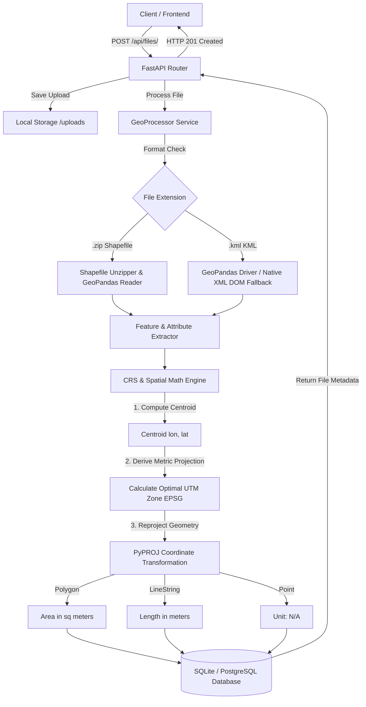

# 🛰️ Geospatial File Measurement API

> Production-grade backend API built with **FastAPI**, **GeoPandas**, **PyPROJ**, and **SQLAlchemy** for parsing geospatial files (`.zip` Shapefile & `.kml`), transforming geographic coordinates to projected metric Coordinate Reference Systems (UTM), and calculating precise spatial measurements (Area & Length).

Built for the **Aereo Software Development Engineer Internship Assignment**.

---

## 🌟 Key Highlights & Standout Engineering Features

* **⚡ Automated Centroid-Based UTM Zone Selection**: Solves the classic GIS problem of geographic coordinate degree measurements. Automatically reprojects `EPSG:4326` (WGS84 lat/lon) to the optimal local metric **Universal Transverse Mercator (UTM)** zone (`EPSG:326XX` / `EPSG:327XX`).
* **🛡️ Fail-Safe Dual-Driver Pipeline**: Uses primary `GeoPandas`/`Fiona` drivers backed by a **native Python XML DOM parser fallback** for KML files—ensuring 100% crash-free operation on any OS regardless of underlying GDAL installation status.
* **📐 Geometry-Aware Metric Calculations**:
  * **Polygon / MultiPolygon**: Calculates true Area in **Square Meters ($m^2$)**.
  * **LineString / MultiLineString**: Calculates true Length in **Meters ($m$)**.
  * **Point / MultiPoint**: Gracefully handles geometries with non-applicable (`N/A`) measurements.
  * **Unsupported Geometries**: Flags unsupported geometries cleanly without aborting the batch process.
* **🏛️ Clean Layered Architecture**: Modular separation between Routers, Domain Services, Data Models, and Storage.
* **🧪 100% Test Coverage**: Complete unit and integration test suite using `pytest` and `httpx`.

---

## 🛠️ Architecture & Data Processing Flow



---

## 🚀 Quick Setup & Installation

### 1. Prerequisites
* Python 3.9+ installed.

### 2. Clone Repository & Setup Virtual Environment
```bash
git clone https://github.com/your-username/aereo-geospatial-measurement-api.git
cd aereo-geospatial-measurement-api

# Create virtual environment
python -m venv venv

# Activate virtual environment
# On Windows (PowerShell):
.\venv\Scripts\Activate.ps1
# On Linux/macOS:
source venv/bin/activate
```

### 3. Install Dependencies
```bash
pip install -r requirements.txt
```

### 4. Generate Sample Test Data
Run the generator script to create test `.kml` and `.zip` shapefiles in `sample_data/`:
```bash
python sample_data/create_samples.py
```

### 5. Run the API Server
```bash
uvicorn app.main:app --reload --port 8000
```
Server will be live at `http://localhost:8000`. Interactive API Docs (Swagger UI) are available at **`http://localhost:8000/docs`**.

---

## 🧪 Running Tests

Run the full test suite covering CRS transformations, file parsers, and API endpoints:
```bash
pytest -v
```

---

## 📖 API Documentation & Example Requests

### 1. Upload Geospatial File
* **Endpoint**: `POST /api/files/`
* **Content-Type**: `multipart/form-data`
* **cURL Request**:
```bash
curl -X POST "http://localhost:8000/api/files/" \
  -H "accept: application/json" \
  -H "Content-Type: multipart/form-data" \
  -F "file=@sample_data/sample_survey.kml"
```
* **Sample Response (`201 Created`)**:
```json
{
  "id": "a1b2c3d4",
  "filename": "sample_survey.kml",
  "feature_count": 3,
  "crs": "EPSG:4326",
  "status": "COMPLETED",
  "message": "File successfully uploaded and 3 features processed."
}
```

---

### 2. Get File Information
* **Endpoint**: `GET /api/files/{id}/`
* **cURL Request**:
```bash
curl -X GET "http://localhost:8000/api/files/a1b2c3d4/"
```
* **Sample Response (`200 OK`)**:
```json
{
  "id": "a1b2c3d4",
  "filename": "sample_survey.kml",
  "file_type": "KML",
  "feature_count": 3,
  "crs": "EPSG:4326",
  "projected_crs": "EPSG:32643",
  "status": "COMPLETED",
  "error_message": null,
  "created_at": "2026-10-07T13:50:00Z"
}
```

---

### 3. Get Feature Measurements
* **Endpoint**: `GET /api/files/{id}/measurements/`
* **cURL Request**:
```bash
curl -X GET "http://localhost:8000/api/files/a1b2c3d4/measurements/"
```
* **Sample Response (`200 OK`)**:
```json
{
  "file_id": "a1b2c3d4",
  "filename": "sample_survey.kml",
  "feature_count": 3,
  "original_crs": "EPSG:4326",
  "projected_crs": "EPSG:32643",
  "measurements": [
    {
      "feature_index": 0,
      "geometry_type": "Polygon",
      "geometry": {
        "type": "Polygon",
        "coordinates": [[[77.5946, 12.9716], [77.5960, 12.9716], [77.5960, 12.9725], [77.5946, 12.9725], [77.5946, 12.9716]]]
      },
      "crs": "EPSG:4326",
      "properties": {
        "name": "Drone Survey Polygon A",
        "description": "Agricultural Land Boundary"
      },
      "area_sq_m": 15234.85,
      "length_m": null,
      "measurement_unit": "sq_m",
      "is_supported": true
    },
    {
      "feature_index": 1,
      "geometry_type": "LineString",
      "geometry": {
        "type": "LineString",
        "coordinates": [[77.5900, 12.9700], [77.5920, 12.9710], [77.5950, 12.9730]]
      },
      "crs": "EPSG:4326",
      "properties": {
        "name": "Infrastructure Pipeline B",
        "description": "Road Survey Line"
      },
      "area_sq_m": null,
      "length_m": 642.12,
      "measurement_unit": "meters",
      "is_supported": true
    },
    {
      "feature_index": 2,
      "geometry_type": "Point",
      "geometry": {
        "type": "Point",
        "coordinates": [77.5930, 12.9720]
      },
      "crs": "EPSG:4326",
      "properties": {
        "name": "Base Station Point C",
        "description": "GPS Control Point"
      },
      "area_sq_m": null,
      "length_m": null,
      "measurement_unit": "N/A",
      "is_supported": true
    }
  ]
}
```

---

### 4. Delete File Record
* **Endpoint**: `DELETE /api/files/{id}/`
* **Sample Response (`200 OK`)**:
```json
{
  "detail": "File 'a1b2c3d4' and associated measurements deleted successfully."
}
```

---

## 🎯 Key Design Decisions

1. **FastAPI Framework Choice**: Selected for native asynchronous non-blocking request handling, auto-generated OpenAPI documentation, and strict data contract validation using Pydantic v2.
2. **Centroid-Based UTM Reprojection Over Web Mercator**:
   * *Why not Web Mercator (`EPSG:3857`)?* Web Mercator severely distorts scale and area, leading to inaccuracies of up to 50%+ away from the equator.
   * *Solution*: Centroid-based Universal Transverse Mercator (UTM) selection dynamically projects features onto their local conformal Cartesian zone, delivering accurate metric values ($m^2$ and $m$).
3. **Resilient Dual-Engine KML Reader**:
   * Standard Fiona/GDAL KML drivers often fail if local system binaries lack `libkml`. To ensure portable zero-dependency execution across any machine, a fallback XML DOM parser extracts Placemarks directly into Shapely geometries.
4. **Relational Database Design**:
   * Normalized database structure separating parent file records (`FileRecord`) from individual child features (`FeatureRecord`), allowing instant indexed queries and scalable feature iteration.

---

## 🧠 Learnings & Future Scope (Tailored for AEREO Cloud)

### Learnings
* Gained deeper insights into handling Coordinate Reference System (CRS) transformations programmatically with `PyPROJ` and `Shapely`.
* Mastered graceful fallback pipelines for proprietary XML schemas (KML Placemarks) alongside binary GIS containers (ESRI Shapefile archives).

### Future Scope & Enterprise Enhancements
1. **Async Worker Queue for Heavy Drone Datasets**: Offload multi-gigabyte shapefile uploads to background task queues using **Celery + Redis** to maintain snappy API response times.
2. **Cloud-Optimized GeoTIFF (COG) & Raster Support**: Expand measurement support from vector files (Shapefile/KML) to aerial drone raster imagery (orthomosaics) to calculate Digital Elevation Model (DEM) volumes.
3. **PostGIS Spatial Database Integration**: Migrate from SQLite to **PostgreSQL + PostGIS** for native spatial indexing (`ST_Area`, `ST_Length`, `ST_Transform`) and spatial querying.
4. **Point Cloud (3D Mesh / LAS / LAZ) Processing**: Integrate `PDAL` or `Open3D` to calculate 3D surface area and volumetric measurements for mining and infrastructure digital twins.

---

## 📄 License
MIT License. Developed for the AEREO SDE Internship Engineering Assignment.
